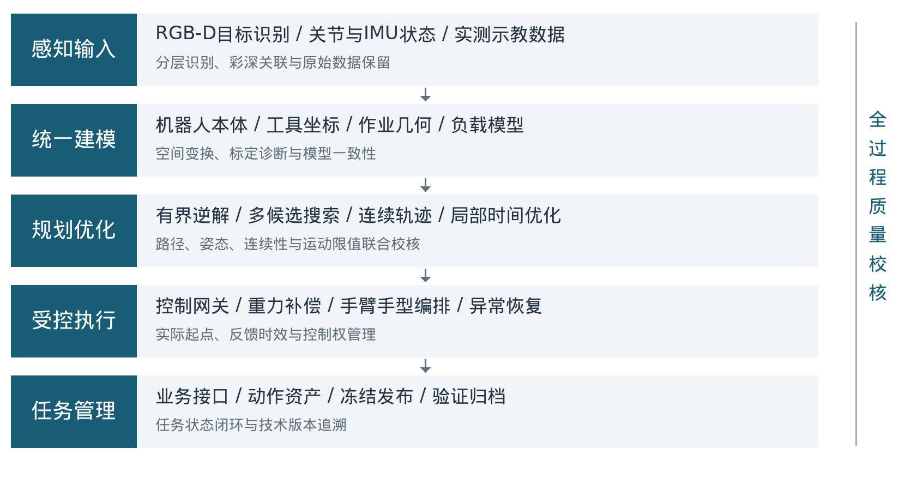
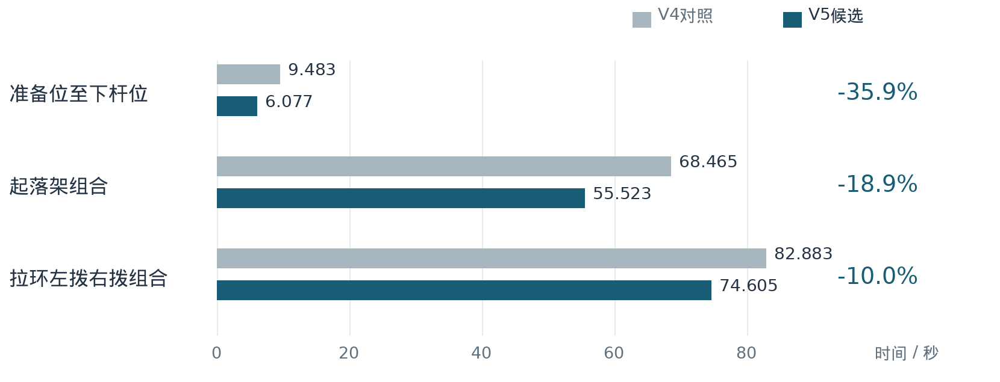

# 人形机器人复杂操作任务：关键技术攻关与调试成果报告

G1 上肢操控系统

编制日期：2026年10月13日

资料周期：2026年8月至9月

---

## 汇报摘要

围绕人形机器人在固定工位开展拉环拨转、滑轨推拉和起落架杆件操控等复杂操作任务，项目完成了上肢操控系统核心技术集成与调试体系建设，形成了集智能感知、统一建模、柔顺示教、约束规划、轨迹优化、执行防护和边缘部署于一体的技术成果。调试工作由单点功能验证拓展为覆盖任务全流程的系统性工程验证，形成了可复用的动作资源、算法模块和技术资料。

### 一是构建了感知与运动统一的技术底座。

完成机器人本体、双臂、腰部、灵巧手及作业对象的统一模型组织，接入两阶段深度学习识别与RGB-D三维定位链路，建立视觉坐标、机器人坐标和末端工具坐标之间的转换与一致性检查机制，使目标识别结果能够转化为具有明确几何含义的操作任务。

### 二是形成了复杂接触操作的规划与示教能力。

集成冗余自由度逆运动学、候选姿态搜索、运动连续性筛选和分阶段任务编排，形成视觉规划与实测示教两条技术路线。完成重力与负载补偿、导纳拖动、姿态保持及动作录制，实现从人工经验动作到结构化机器人轨迹资源的转化。

### 三是完成了运动品质与执行可靠性专项攻关。

针对轨迹跳变、内部停顿、低速迟滞、规划与控制限值不一致、界面回调干扰反馈等问题，建立连续多项式轨迹处理、空间偏差预算、局部时间优化、分层看门狗和异常恢复机制。在同配置离线对比中，起落架组合时长由68.465秒优化为55.523秒，内部低速谷由32处减少至8处；拉环组合时长由82.883秒优化为74.605秒。

### 四是实现了任务资源工程化部署与全过程留痕。

完成Jetson边缘端原生执行链路、任务接口和版本校验机制建设，形成任务受理、动作执行、状态查询、结果回传、停止恢复及资源归档的统一流程。2026年9月28日归档记录显示，拉环组合任务完成并返回成功状态，体现了技术成果向实际执行流程的转化。

总体成果：已形成“感知识别→约束求解→示教复现→连续优化→受控执行→数据归档”的一体化上肢操控技术体系，完成核心技术建设与代表性任务调试，形成可复用、可追溯的成套工程成果。

---

## 一、项目目标与完成情况

### （一）总体目标

面向固定工位的典型操控对象，构建能够连接视觉目标、机器人运动能力、人工示教经验与上层业务指令的统一执行系统。重点解决复杂上肢机构自由度冗余、工具坐标不统一、接触路径难以直接规划、示教动作难以高质量复用以及调试软件向机载环境迁移等工程问题，形成可管理、可复现、可追溯的技术成果。

### （二）完成情况

| 建设方向 | 已完成的技术成果 | 形成的能力 |
| --- | --- | --- |
| 统一模型与坐标 | 本体、双臂、腰部、工具与手部模型集成；坐标链路一致性校核 | 统一几何表达与目标解析 |
| 视觉感知与诊断 | 两阶段识别、彩深三维映射、相机与TCP分项标定诊断 | 目标定位与误差分层分析 |
| 柔顺示教与控制 | 负载辨识、重力前馈、导纳拖动、保持及分阶段控制 | 操作经验采集与受控复现 |
| 约束运动规划 | 候选姿态搜索、有界逆解、局部连续性治理与路径筛选 | 复杂操作路径生成 |
| 轨迹品质优化 | 五次样条、局部高阶过渡、时间优化与连续限值校验 | 运动平顺性及节拍优化 |
| 任务集成 | 拉环、滑轨和起落架三类任务的软件流程与动作资源组织 | 按业务阶段组合执行 |
| 执行防护 | 反馈时效、跟踪误差、力矩温度、控制权及恢复状态管理 | 执行条件闭环管理 |
| 边缘部署与归档 | Jetson原生链路、接口适配、不可变发布与哈希校验 | 机载运行与版本追溯 |

项目成果既包括算法与控制模块，也包括任务流程、动作资产、可视化工具和验证证据。通过统一技术底座，各类任务采用一致的数据组织、轨迹表达和执行接口，减少了专项功能之间的重复建设。

---

## 二、总体技术路线

项目采用分层解耦、闭环校核的技术路线，将感知、建模、规划、执行与管理划分为相互衔接的能力层。上层负责业务语义与动作组合，中层负责运动约束与轨迹品质，底层负责实时状态和控制输出，各层通过统一数据与状态契约完成协同。

### （一）感知建模与任务求解协同

以目标图像、深度数据、关节状态和机器人模型为基础，将作业对象转换为插入点、旋转中心、操作方向、示教端点等任务参数，再通过有界求解与阶段化规划生成动作。对固定工位重复任务，采用实测示教路径复用，保留人工确定的有效操作几何。

### （二）轨迹生成与执行验证协同

对候选路径进行几何检查、连续性处理和时间参数化，统一预览与执行使用的轨迹数据。执行端再次核查实际起点、状态时效和运动限值，避免仅依据规划成功状态下发动作。

### （三）任务运行与成果管理协同

通过任务编号、执行状态、版本哈希和日志归档关联每次调试过程，使模型、参数、动作及验证结果能够对应到同一技术版本，形成贯穿开发、调试、部署和复核的管理链路。

---

## 三、关键技术成果

01 / 统一建模与误差解耦

### （一）多层级空间建模与标定一致性技术

完成基于机器人描述模型的运动学与任务几何集成，统一组织双臂、腰部偏航、腕部、掌部、食指工具点以及作业对象的空间关系。采用刚体变换链将图像光学坐标、躯干坐标、骨盆坐标与末端工具坐标关联，解决不同模块对“末端位置”和“操作目标”理解不一致的问题。

#### 1. 统一工具点与作业对象的几何语义

明确区分旋转轴心、环内插入点、虚拟圆弧中心、腕部安装点与食指TCP，建立不同工具配置下的目标换算机制。同步规划模型、显示模型和手部碰撞几何，避免模型外观、末端参考与实际规划参数各自独立维护。

#### 2. 建立A/B/C分项误差诊断体系

将末端工具点一致性、RGB与深度一致性、相机安装外参一致性分别组织为独立诊断流程。TCP采用多姿态公共触点的SVD最小二乘求解；标定板采用ChArUco角点与平面PnP求位姿；相机外参采用基于机器人运动链的手眼标定求解，并以姿态覆盖、矩阵条件数和留出样本进行质量校核。

#### 3. 形成可复算的标定分析成果

完成采样窗口稳定性检查、原图及状态关联、拟合与验证分组和参数敏感性分析。相机外参候选在归档验证组中，平移链路残差RMS由11.717毫米降至5.591毫米，旋转残差RMS由1.688度降至1.169度，形成了具有独立留出数据支持的一致性改善结果。

| 技术手段 | 解决的调试问题 |
| --- | --- |
| 刚体变换链与工具配置 | 消除坐标方向、单位和工具点定义混用 |
| SVD与条件数分析 | 识别姿态覆盖不足及数值求解退化 |
| PnP与手眼标定 | 分项评价视觉位姿与相机安装一致性 |
| 留出验证与留一分析 | 提高参数评估的可解释性和可追溯性 |

本页标定数值为变换链一致性残差，表达模型分析效果，不作为实体末端绝对定位精度指标。

---

## 三、关键技术成果

02 / 深度学习感知与几何语义融合

### （二）分层视觉识别与RGB-D三维任务构建技术

集成两阶段YOLOv8目标识别链路，先识别整体操作对象，再对内部关键区域进行二次定位，将通用目标检测结果转化为具体操作所需的几何关键点。结合对齐深度帧和相机内参完成三维反投影，形成从图像目标到机器人空间任务的完整数据处理链路。

#### 1. 两阶段识别与任务关键点提取

第一阶段完成轮盘整体区域检测，第二阶段定位内部黑色圆盘区域；进一步计算圆盘中心、手指操作区、对角线交点与操作点。通过区域检测与几何构造相结合，明确“识别到对象”与“获得可操作目标”之间的转换关系，形成任务导向的感知结果。

#### 2. 彩深关联与坐标转换

保留彩色图、原始对齐深度、帧号、时间戳、相机内参及彩深外参，检查彩深帧关联、尺寸编码、深度有效性与二维三维重投影一致性。对有效点完成相机光学坐标到机器人参考坐标的转换，并依据操作平面和进入方向组织插入、准备及圆弧参数。

#### 3. 目标与场景的采集时刻冻结

将目标几何与采集时刻的机器人姿态绑定，避免腰部后续运动带动外部目标坐标“漂移”。保存原始识别点与任务构造点，清晰区分感知数据、几何假设和规划输入，使目标解析过程可复核、可重放。

#### 4. 视觉资料资产化与可视化复核

形成RGB-D原始数据归档、彩色点云展示、目标标记、历史场景回放和模型叠加能力。通过单次采集结果与对应机器人状态的关联，可在不重复占用现场硬件的条件下进行算法复算、路径对比及问题分析。

解决问题：将视觉识别、三维几何和运动规划贯通，消除仅凭二维框选难以定义操作点、历史图像难以复算以及目标坐标随机器人姿态变化而混淆等问题。

---

## 三、关键技术成果

03 / 模型驱动控制与柔顺交互

### （三）重力负载补偿与导纳示教技术

面向机械臂末端安装灵巧手、相机及连接件后的负载变化，构建模型驱动的重力前馈与姿态保持控制。结合多姿态静态力矩记录开展末端负载质量和重心辨识，使补偿参数与实际安装配置关联，为柔顺拖动、低速操控及轨迹复现提供控制基础。

#### 1. 负载参数辨识与动态重力前馈

利用运动学动力学链计算本体重力项，将额外负载表示为质量与质量一阶矩参数，通过SVD回归估计质量和重心。控制过程中结合当前实测关节与IMU姿态更新重力方向，形成随机器人姿态变化的前馈补偿，降低仅依靠位置误差产生支撑力矩的需求。

#### 2. 力矩锚定与平滑控制接管

接管前采集静止窗口的估计力矩，检查样本数量、波动与关节状态，以实测姿态和力矩作为初始支撑参考，再按时间过渡到模型补偿。轨迹入口采用五次平滑衔接，保持指令及运动边界连续，降低模式切换时的瞬态变化。

#### 3. 有界导纳与示教意图管理

采用残余力矩驱动的导纳参考生成，将模型力矩与估计力矩的差值经零偏、低通滤波和死区处理转换为拖动速度。对参考速度、加速度、测量位置超前量和关节限位进行约束；通过操作者显式进入、持续按键意图及释放制动机制组织拖动和保持状态。

#### 4. 分关节补偿与分阶段控制配置

针对肩肘负载、腕部振荡和腰部低速黏滞等不同表现，配置分关节比例阻尼及有界积分补偿，设置反向、脱黏、过载和恢复时的积分衰减或清零机制。任务准备、记录回放和停止恢复采用不同控制配置，并在静止阶段边界原子切换，使运动品质与异常处置各自匹配任务状态。

解决问题：形成负载可辨识、拖动有约束、模式可切换、姿态可保持的控制能力，将人工调试经验沉淀为可复用示教资源。

---

## 三、关键技术成果

04 / 冗余自由度约束求解

### （四）任务约束逆运动学与多策略路径规划技术

针对七自由度机械臂存在多解、局部不可达、腕部变化较大及相邻路径点分支切换等问题，建立候选姿态生成、局部有界求解、连续性评分与阶段完整性检查相结合的规划框架。根据任务路线选用单臂或单臂与腰部协同求解，将位置、姿态、关节余量及连续性纳入统一筛选。

#### 1. 可达能力表达与多初值搜索

采用KDL正逆运动学及位置、方向分箱能力图组织工作空间信息，利用已知有效关节状态提供逆解初值。对插入倾角、方位、工具自转和关节种子进行组合搜索，通过多样性筛选减少候选集中于同一姿态分支的情况，提高复杂目标的搜索覆盖。

#### 2. 有界非线性逆解与解析雅可比

采用带关节边界的非线性最小二乘求解，将TCP位置、姿态及连续性参考组织为求解目标，利用几何雅可比提供梯度。对特定接触几何开展约束优化候选求解，将切向关系、姿态偏转和相邻关节变化作为可检查条件，形成面向任务几何的逆解能力。

#### 3. 连续性评分与局部自适应细分

综合关节总变化、腕部变化、关节限位余量与工具姿态变化评价解的质量。通过上一段斜率预测、斜率变化惩罚和局部路径细分，修复相邻逆解跳变；对完整任务同时检查插入、操作、退出和返回阶段，避免仅验证某一目标点可达。

#### 4. 分级路径策略与模型碰撞筛选

端点规划优先尝试笛卡尔直线路径，并在适用路线中以OMPL/RRTConnect进行绕障或返回路径搜索。视觉规划对模型关节限位、局部环境与任务相关碰撞进行筛选，并对轨迹插值后路径再次核查。示教回放则保留记录几何，采用有界衔接连接实际起点和记录端点，满足固定工位动作复现的使用方式。

解决问题：将单点逆解提升为完整任务路径求解，改善局部跳变、姿态分支集中、退出受限和路径阶段不完整等调试问题。

---

## 三、关键技术成果

05 / 实测轨迹资产与高保真复现

### （五）独立高频采集与路径时间解耦技术

建立从底层LowState直接采集实测运动的独立只读通路，原始记录包含关节位置、速度、估计力矩、电机状态、源时间戳及接收时间。采集通路与界面显示、规划计算和手部服务分离，使示教资料能够完整表达机器人实际运动过程。

#### 1. 原始数据保留与停止窗口校核

按接收的独立采样保存原始数据，不以规划目标或人工插值点替代实测状态。结束录制时立即固定单调时间截止点，排除截止后的数据，再核查截止前的静止窗口。录制失败或取消保留原始诊断资料，不覆盖上一条有效动作。

#### 2. 几何特征取点与连续曲线拟合

依据模型末端累计位移、旋转变化和关节变化保留关键点，在转折区域保留原始样本。采用五次B样条和分段五次插值表达路径，保持起终点及相应运动边界，对照原始记录检查TCP、姿态和关节路径差异，形成带质量约束的示教轨迹。

#### 3. 路径与时间分离，统一受限调速

将“沿哪条路径运动”与“以什么速度运动”分离处理。端点规划集成TOTG时间参数化与Ruckig平滑；记录回放采用路径保持的倍率调整和局部时间优化，在已有速度、加速度、加加速度及腰部限制内求得可用时间线。手指等待和业务顺序独立保留，避免臂部调速改变握持时序。

#### 4. 连续插值一致性与复用缓存

规划、可视化和执行采用一致的轨迹结构，执行端根据位置、速度和加速度进行五次Hermite插值。通过模型、原始录制、手型、参数和实现版本构建缓存标识，复用经过验证的轨迹单元，并为当前实测起点重新生成必要衔接。

解决问题：消除界面卡顿对示教数据的干扰，避免人工停顿被机械复刻以及反复拟合导致版本不一致，实现示教动作的高质量保存、查询与复用。

---

## 三、关键技术成果

06 / 连续轨迹品质与节拍优化

### （六）空间偏差预算约束的局部平顺与去停顿技术

针对录制抖动、编辑边界和过密节点带来的反复减速，构建空间约束与时间约束协同的轨迹优化方法。通过低速谷诊断区分可优化的内部迟滞与必要换向、端点停稳和手指等待，仅对符合条件的局部区间进行替换。

#### 1. 高阶过渡与连续运动边界保持

采用局部五次C2替换与七次Hermite过渡，匹配区间两侧的位置、速度、加速度，七次候选进一步匹配加加速度。搜索窗口、偏移及持续时间，对真实反向和不合格候选保持原路径，形成有明确选择规则的运动品质优化。

#### 2. 连续偏差界与预算累计管理

通过单调路径对应和Bernstein多项式界评价连续曲线偏差，分别管理接触段与非接触段的TCP、关节及姿态预算。多次编辑累计核算剩余预算，防止局部处理反复叠加造成总体路径偏移。

#### 3. 局部时间优化与解析限值校验

采用SLSQP调整路径局部运行速率，再校核连续多项式的速度、加速度、加加速度峰值、关节位置极值及控制周期步长。以满足相同约束的原路径作为对照，择优采用经过验证的结果，形成兼顾节拍、路径保持和运动品质的优化方法。

图中时长取V4/V5相同录制版本与组合条件；优化收益为离线轨迹结果，保留业务等待和单元端点。

---

## 三、关键技术成果

07 / 执行防护与时序可靠性

### （七）多层执行门控与异常状态管理技术

建立由操作授权、状态准入、轨迹校验、运行监测和停止恢复组成的多层执行防护。规划成功、界面显示和任务提交分别采用不同状态，硬件输出由独立网关统一处理，实现操作意图与控制动作之间的明确约束。

#### 1. 执行前准入与运行中多维监测

执行前检查实测起点、关节范围、轨迹导数、机器人服务状态及控制权；运行中监测反馈年龄、目标步长、跟踪误差、估计力矩、温度和电机状态。采用跟踪误差减速、暂停、受支撑阻尼恢复和故障静默等分级处理，避免不同异常都被简单等同为任务成功或普通退出。

#### 2. 控制权唯一性与动作代次校验

通过本地互斥、机载服务检查和DDS端点身份观察核查命令来源，区分调试端、机载任务端与机器人原生服务。使用计划代次、停止代次和唯一任务编号关联动作授权；停止、设置变化或任务失败后旧计划失效，减少陈旧请求及重复下发造成的控制冲突。

#### 3. 单调时钟与反馈回调隔离

状态新鲜度采用单调时钟记录，避免系统时间跳变导致错误判断。将关键状态订阅放入独立回调组或独立执行器，减少规划、界面和服务调用对反馈处理的影响；记录回调间隔、消息年龄和锁等待信息，提高时序问题的定位能力。

#### 4. 有条件恢复与任务终态保持

恢复流程基于已知记录检查点、停止确认、健康反馈和控制权保持构建。对符合条件的异常执行一次有界准备位恢复，采用记录的接近或退出路线组织动作；失败任务保留失败终态，新动作使用新任务编号，不以恢复结果改写原任务记录。

解决问题：统一了规划限制与执行保护的校核关系，分离界面时效和底层反馈时效，形成可诊断、可追溯、具备明确终态的任务异常处理体系。

---

## 三、关键技术成果

08 / 云边端协同与工程化部署

### （八）边缘原生执行与不可变资源发布技术

完成由调试工作站向Jetson边缘计算平台的运行链路迁移，将轨迹资源、原生控制网关、任务编排与HTTP业务接口组合为机载执行系统。通过软件结构验证、跨架构数值核对和现场部署回执，形成算法结果进入边缘运行环境的工程化交付路径。

#### 1. 跨架构、跨运行环境适配

针对开发端与ARM64机载端在ROS版本、接口定义、依赖和DDS运行库上的差异，采用私有兼容层、原生构建和进程级依赖配置组织适配。控制插值公式保持一致，对相同轨迹逐采样比较位置、速度和加速度，验证迁移过程中的数值一致性。

#### 2. 业务接口与执行状态闭环

构建任务受理、初始化、状态查询、停止、恢复及回调接口，使用唯一任务编号与持久状态组织请求。通信中继保持原请求、业务错误和回调地址，面对不确定应答优先查询已有任务而非重复发送运动，实现业务流程与机器人动作之间的状态对应。

#### 3. 参数化任务组合与有界资源生成

起落架任务以循环次数、前置动作和末轮方式描述业务需求，将已验证运动单元组织为对应动作序列。采用分块惰性组合和C2衔接，保留准备、握持、松手及退出流程，避免大次数任务一次性展开造成资源占用和时序管理困难。

#### 4. 冻结快照、完整性校验与版本回退

动作发布绑定源录制、模型、参数及实现版本，形成不可变快照和清单，以SHA-256验证传输前后内容。加载和切换过程组织结构检查、父版本核对、旧版备份及回执归档；候选资源暂存与运行版本激活采用独立流程，保证技术成果的版本关系可查。

解决问题：完成机载运行环境差异适配、上层接口与控制状态衔接以及动作版本管理，形成可移交、可维护的边缘端任务执行能力。

---

## 四、典型任务调试成果

### （一）拉环拨转：形成完整动作链与示教复现成果

围绕接近、手型准备、插入、拨动、退出和返回等操作阶段，完成视觉任务规划与实测示教回放两类流程。通过固定采集目标、区分轴心与圆弧参考、筛选连续逆解以及复用记录动作，解决目标语义混用、腕部姿态变化、局部逆解分支切换和退出路径受限等问题。

建立左拨与右拨动作单元、准备位与记录起点衔接、完整组合预览和受控执行链路。2026年9月20日两轮左臂记录回放完整流程成功结束；2026年9月28日拉环组合任务返回成功状态，归档记录轨迹时长74.605秒，形成了从示教资源到机载组合执行的代表性成果。

### （二）滑轨推拉：形成分向记录、手臂手型协同与局部优化能力

围绕推进与拉出方向分别组织接近、接触和退出记录，建立张开、推进握持和拉出握持三类手型资源。端点由各方向录制末帧直接产生，配合受限衔接、手型等待和当前起点核查形成完整动作编排，解决不同方向路径不一致、手型切换时机不清和每次重复拟合等问题。

完成记录缓存、原始路径约束下的平顺拟合以及局部时间优化工具。归档离线候选中，拉出退出段时长由9.701秒优化为7.758秒，内部停顿由1处减为0处；拉出接近段由22.007秒优化为17.000秒。形成毫米级几何调整的独立对比与连续导数校核工具，使几何修改与节拍优化可以分别评价。

### （三）起落架杆件操控：形成业务语义驱动的可组合动作体系

将准备位接近、上下行操作、握持松手和退出组织为独立动作单元，统一记录源、模型和边界条件。通过循环次数、前置下放与末轮回收方式映射业务路径，解决单行程、往返周期和完整业务流程之间容易混淆的问题。

完成局部去停顿、C2拼接、分块重复和控制进度校核。归档同配置离线对比中，准备位至下杆位单元内部低速谷由7处降至0处，起落架组合时长由68.465秒降至55.523秒。2026年9月28日任务协议更新完成Jetson部署，配套服务与四类组合配方加载核验通过。

本页分别列示完整实机动作流程记录、离线轨迹优化成果和软件部署核验；任务完成状态对应机器人动作序列，机构外部状态由业务系统按其信号定义管理。

---

## 五、量化成果与验证情况

项目采用“实机记录、离线对比、软件回归、部署核验”相结合的验证方式，围绕代表性任务和共性技术保留了量化证据。以下结果来自对应归档批次，评价对象与数据口径逐项明确。

| 成果项目 | 归档结果 | 验证口径 |
| --- | --- | --- |
| 拉环完整回放 | 2026-09-20两轮完整动作流程成功结束 | 实机执行日志分析 |
| 机载拉环组合 | 2026-09-28任务成功；记录轨迹74.605秒 | 任务终态与运动日志 |
| 相机平移一致性 | RMS 11.717→5.591 mm，改善约52.3% | 外参候选留出组残差 |
| 相机旋转一致性 | RMS 1.688→1.169度，改善约30.8% | 外参候选留出组残差 |
| 准备位接近单元 | 9.483→6.077秒；内部低速谷7→0 | V4/V5同配置离线对比 |
| 起落架组合 | 68.465→55.523秒；低速谷32→8 | V4/V5同配置离线对比 |
| 拉环组合 | 82.883→74.605秒；低速谷21→8 | V4/V5同配置离线对比 |
| 滑轨拉出退出 | 9.701→7.758秒；内部停顿1→0 | 有界候选离线对比 |
| 跨架构插值一致性 | 16段、10,799个采样；三类量误差均小于1×10⁻¹⁰ | 开发端/ARM64数值比对 |
| 反馈回调隔离 | 6秒干扰测试最大消息间隔9.11 ms | 只读反馈通路测试 |
| 轨迹优化回归 | 78项测试通过；16个任务面板加载播放核验 | V5软件与离线界面验证 |
| 起落架协议回归 | 本地58/58；暂存运行环境26/26 | 两个独立测试批次 |

### （一）运动效率与品质实现协同改善

起落架组合在同一软件加加速度策略与相同组合条件下，时长缩短约18.9%，内部低速谷减少75.0%；拉环组合时长缩短约10.0%，内部低速谷减少约61.9%。评价同时考虑运动时间和停顿数量，保留必要动作顺序及手指等待。

### （二）验证结果实现批次化、版本化留存

对轨迹导数、模型路径偏差、协议语义、异常状态和版本完整性分别建立测试记录。测试结果绑定相应源文件与运行环境，能够按具体成果复查，形成技术管理所需的证据链。

说明：各批次回归用例可能重叠，不合并为唯一累计测试数；离线轨迹时长按相应动作范围计算，不等同于包含所有现场等待的业务总耗时。

---

## 六、技术特色与综合成果

### （一）技术特色

1. 任务导向的多算法协同。将深度学习感知、空间标定、冗余逆解、样条拟合、连续时间优化和状态机编排组织为一致技术链路，算法能力直接对应操作任务的几何要求与执行阶段。

2. 约束贯穿的运动品质治理。将路径偏差、位置连续性、速度加速度及加加速度检查贯穿轨迹生成、编辑、调速、组合和执行准入，形成从单条曲线到完整任务的统一质量管理。

3. 经验动作的数字资产沉淀。以原始实测记录为基础，将示教动作转化为带模型、参数、手型及验证信息的资源单元，实现人工经验的可保存、可查询、可组合与可复用。

4. 开发调试与边缘部署一体化。保持开发端与机载端轨迹表达和插值方法一致，通过兼容层、原生构建、版本校验和部署回执连接开发验证与机载执行。

5. 调试过程的证据化管理。以任务编号、原始数据、模型快照和版本哈希关联现场记录与软件结果，提升问题分析效率和成果复核质量。

### （二）交付成果清单

| 成果类别 | 已形成的交付内容 |
| --- | --- |
| 模型与配置 | 机器人、手部、工具与任务场景模型；控制及规划参数 |
| 算法与控制 | 视觉解析、标定诊断、负载补偿、导纳、规划和轨迹优化模块 |
| 任务动作资源 | 拉环、滑轨、起落架录制数据、动作单元、组合轨迹及冻结快照 |
| 调试与展示 | 任务面板、轨迹对比、RGB-D回放和机器人模型可视化 |
| 边缘执行 | Jetson原生网关、任务编排、业务接口及资源发布工具 |
| 验证与资料 | 调试日志、回归报告、数值对照、部署回执和成果总结 |

### （三）总体成果结论

项目已完成G1机器人上肢复杂操作系统的核心技术集成和调试能力建设，形成覆盖感知、示教、规划、优化、执行及部署的成套技术成果。围绕拉环拨转、滑轨推拉和起落架杆件操控建立了任务流程与动作资产，并通过代表性实机动作记录、离线对比、软件回归和部署核验形成配套证据，为专项成果汇报、技术资料归档及同类工位复用提供了完整支撑。
